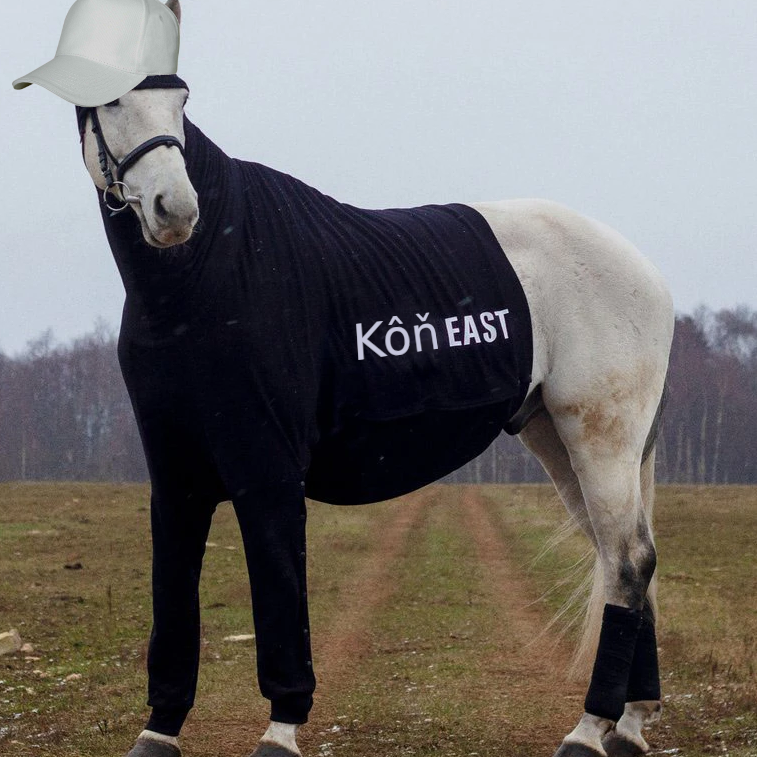

# Kôň West

### CONCERT ON 31 NOVEMBER 2022!!!

<a 
href="https://l.instagram.com/?u=https%3A%2F%2Fopensea.io%2Fassets%2Fmatic%2F0x2953399124f0cbb46d2cbacd8a89cf0599974963%2F23563407073517733053545900018605031025686972917217501683495488659914366124132&e=ATMBPXV28V_x5AbPAchqfMlHyDoY_b0wvF7rKg_T4b5-4Tj7ADFo5er5z65bHzOKn2czieLEAVNCaxJqTy78Zsc&s=1"
alt="OpenSea Link"
style="
	background-color: black;
	border-radius: 2rem;
	padding: .5rem 1rem;
	color: white;
	display: block;
	text-align: center;
">
	GET NFT CONCERT TICKET
</a>

#### Who is Kôň West?

Kôň West is the Slovak cousin of Kanye West.
Kanye West always denied the existance of Kôň,
but Kôň didn't let that bring him down.

#### When did Kôň West appear?

Kôň West (pronounced "konye west") appeared first at the [Faculty of Foreign Languages and Literatures](https://lls.unibuc.ro).
He appeared in the Slovak class. "Kôň" means horse in slovak.

#### Where is the merch?

We plan on adding merch for Kôň West. This merch will not be 
a joke. I am warning you, if you buy, you WILL get the bought
merch.

#### What the fuck?

"Kôň West" is just a joke that was born in the Slovak class at [FLLS](https://lls.unibuc.ro).
"Kôň" meaning horse, pronounced "konye" and sounding a lot
like "Kanye", gave birth to "Kôň West", a fictional meme character.
